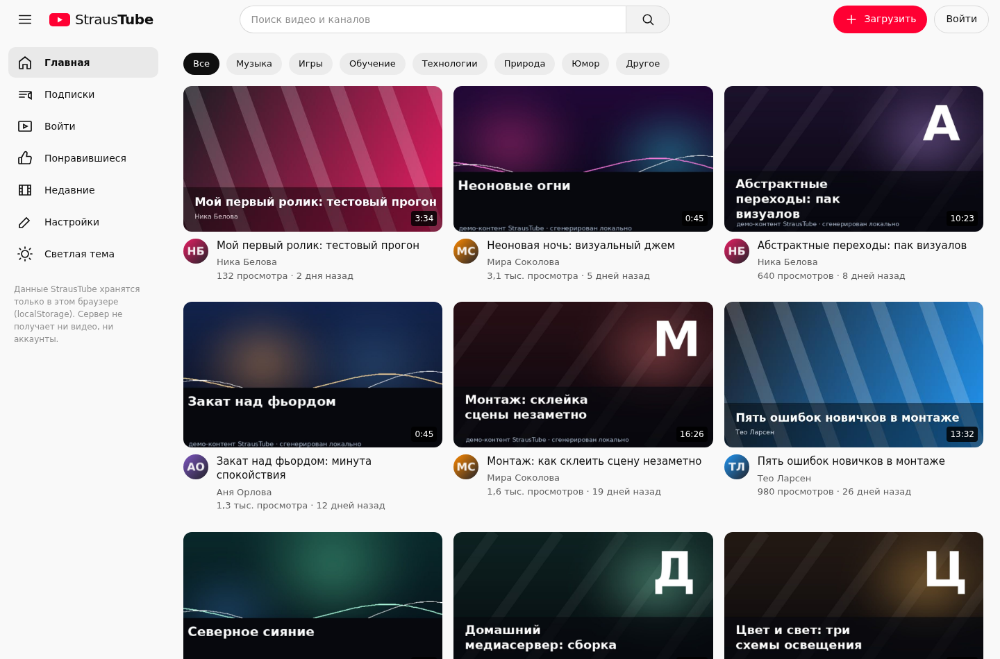
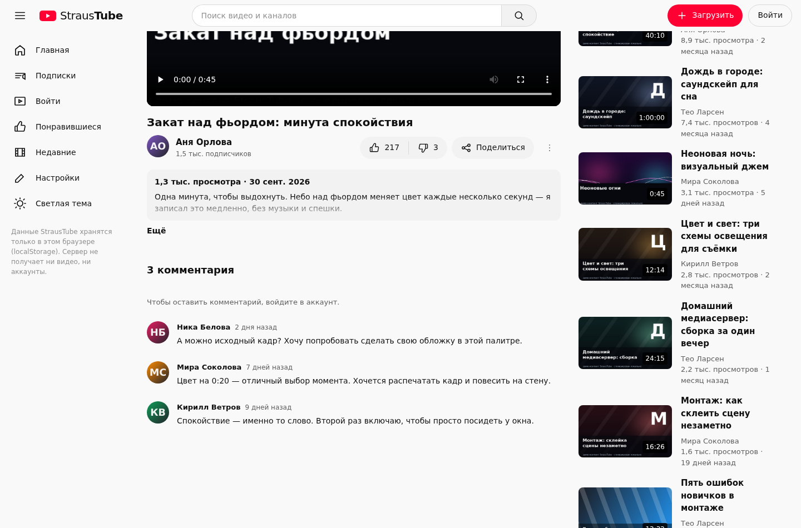
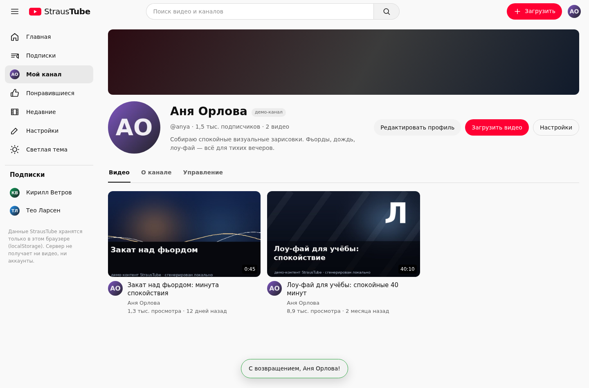
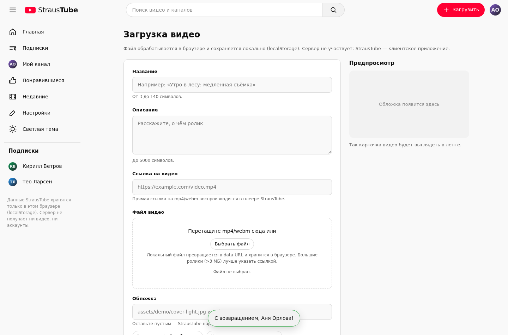
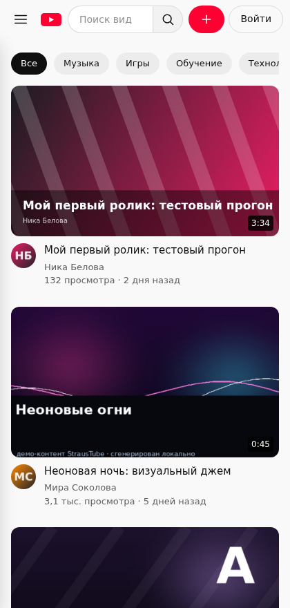
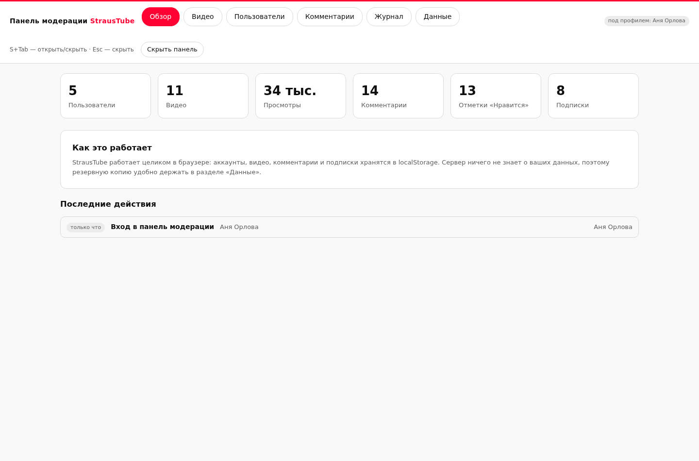

# StrausTube

Демонстрационный видеохостинг: лента, каналы, плеер, лайки, комментарии, подписки
и загрузка видео. **Работает целиком в браузере** — все данные (аккаунты, ролики,
комментарии) хранятся в `localStorage` пользователя. Сервер только раздаёт статику,
поэтому база данных не нужна.



---

## Содержание

- [Возможности](#возможности)
- [Быстрый старт](#быстрый-старт)
- [Деплой на Render](#деплой-на-render)
- [Служебная панель модерации](#служебная-панель-модерации)
- [Где хранятся данные и какие у них лимиты](#где-хранятся-данные-и-какие-у-них-лимиты)
- [Безопасность и почему браузер не показывает предупреждений](#безопасность-и-почему-браузер-не-показывает-предупреждений)
- [Структура проекта](#структура-проекта)
- [Тесты](#тесты)
- [Демо-контент](#демо-контент)

---

## Возможности

**Аккаунты и профили**

- Регистрация по никнейму и паролю, вход, выход, «запомнить меня».
- Переключение между аккаунтами браузера без раскрытия чужих паролей.
- Редактирование профиля: имя, описание канала, аватар (файл или ссылка https).
- Пароли не хранятся в открытом виде: только соль и производный ключ
  (многократный SHA-256 через Web Crypto).

**Видеохостинг**

- Главная лента с категориями и рекомендациями.
- Просмотр в собственном плеере (`<video>`), лайки/дизлайки, комментарии,
  подписки, счётчик просмотров.
- Страницы каналов: свои и чужие, с вкладками «Видео», «О канале», «Управление».
- Загрузка видео: название, описание, категория, обложка (файл, ссылка или
  автоматическая генерация на `<canvas>`), файл видео (mp4/webm) или ссылка.
- Поиск по видео и каналам, страница «Понравившиеся», меню аккаунта.

**Оформление**

- Тёмная и светлая темы, адаптивная вёрстка (меню сворачивается, мобильный вид).

<table>
  <tr>
    <td></td>
    <td></td>
  </tr>
  <tr>
    <td></td>
    <td></td>
  </tr>
</table>

---

## Быстрый старт

Нужен Node.js 18 или новее.

```bash
cd straustube
npm install
npm start
# открыть http://localhost:3000
```

Скриптов сборки нет: это статические файлы из `public/` плюс маленький
`server.js` на Express, который добавляет заголовки безопасности.

---

## Деплой на Render

Приложение не требует базы данных и подходит для бесплатного тарифа Render.
Рекомендуемый способ — «Blueprint» из этого репозитория.

### Вариант 1. Blueprint (файл `render.yaml` уже в проекте)

1. Загрузите проект в репозиторий на GitHub/GitLab.
2. В Render: **New → Blueprint**, выберите репозиторий.
3. Render прочитает `render.yaml` и создаст Web Service:
   - **Runtime:** Node
   - **Build Command:** `npm install --omit=dev`
   - **Start Command:** `npm start`
   - **Health Check Path:** `/healthz`
   - **Plan:** Free
4. Нажмите **Apply**. Через пару минут сайт будет доступен по адресу
   `https://<имя-сервиса>.onrender.com`.

### Вариант 2. Вручную

1. **New → Web Service**, подключите репозиторий.
2. Runtime: **Node**; Branch: ваша основная ветка.
3. Build Command: `npm install --omit=dev`
4. Start Command: `npm start`
5. Instance Type: **Free**. При необходимости задайте переменные окружения
   `NODE_VERSION=20`, `NODE_ENV=production`.

### Важно про базы данных на Render

**Создавать базу не нужно.** Бесплатный Render Postgres живёт ограниченно —
он **истекает через 30 дней** после создания (далее 14 дней на апгрейд, потом
удаление), а бесплатный Key Value не сохраняет данные между перезапусками.
StrausTube спроектирован так, чтобы этого избежать: аккаунты и видео живут
в браузере пользователя, сервер о них ничего не знает. Поэтому «бесплатная
датабаза» не нужна вовсе — и данные не пропадут вместе с ней.

### Особенности бесплатного тарифа

- Сервис **засыпает после ~15 минут без запросов** и просыпается при первом
  обращении примерно за минуту. Это нормально для демо.
- 750 бесплатных часов инстанса в месяц на воркспейс.
- Эфемерный диск: ничего не нужно сохранять на сервере (и приложение этого
  и не делает).

### Другие площадки

Подойдёт любой хостинг статики, но `server.js` добавляет заголовки
безопасности (CSP и другие). Если размещать только `public/`, политику
безопасности лучше задать средствами площадки (в Netlify — файл `_headers`,
в Cloudflare Pages — правила заголовков).

---

## Служебная панель модерации

- **Секретная комбинация:** зажмите `S` и нажмите `Tab`
  (в полях ввода комбинация намеренно не срабатывает; `Esc` скрывает панель).
- Панель **не входит в публичный интерфейс**: её нет ни в одном меню,
  она не индексируется (`robots.txt`), монтируется отдельным слоем только
  на время открытия.
- Для входа нужен ключ модератора. Он проверяется локально как производный
  ключ парольной функции (SHA-256 × 1500), а не как строка, поэтому в коде
  лежит только хеш.
- **Сменить ключ:** выполните `node tools/make-admin-key.js` — утилита напечатает
  новый ключ и его хеш; хеш вставьте в `public/js/seed.js` в поле
  `KDF.adminExpectedHash`, новый ключ сохраните у себя. В репозиторий ключ
  не попадает, там остаётся только хеш.

**Возможности панели**

| Раздел | Что можно делать |
| --- | --- |
| Обзор | Статистика библиотеки, журнал последних действий |
| Видео | Поиск, правка названия/описания/категории/канала, обложки, ссылки на файл, просмотров и стартовых оценок, удаление, быстрый переход |
| Пользователи | Создание профилей, вход под любым профилем, возврат к своему, смена имени, ника, описания, аватара, роли, стартовых подписчиков, удаление профиля вместе с его контентом |
| Комментарии | Правка и удаление любых комментариев |
| Журнал | История действий модератора (до 200 записей) |
| Данные | Экспорт/импорт JSON, догрузка демо-данных, полный сброс |

**Ограничение, о котором стоит знать честно:** приложение полностью клиентское,
поэтому «админ-доступ» — это инструмент удобства для владельца браузера, а не
защита от него. Данные лежат в `localStorage`, и владелец устройства в любом
случае может их изменить. Если когда-нибудь понадобится настоящая многопользовательская
система с серверной авторизацией — это уже другая архитектура (сервер, БД, роли).



---

## Где хранятся данные и какие у них лимиты

- Ключ `straustube.db.v1` в `localStorage`: аккаунты, видео, комментарии,
  лайки, подписки, журнал модерации.
- Ключ `straustube.session.v1`: активная сессия (в `sessionStorage`, и в
  `localStorage` при «запомнить меня»).
- `straustube.theme.v1`: выбранная тема.
- Режим модератора: `straustube.admin.v1` в `sessionStorage` (сбрасывается
  с закрытием вкладки).

**Лимит хранилища.** Браузеры дают `localStorage` около 5 МБ на источник.
Видеофайл сохраняется как data-URL и занимает примерно на треть больше своего
размера, поэтому в форме загрузки есть мягкое ограничение: файлы крупнее
**~3,5 МБ** лучше добавлять ссылкой на mp4/webm. Обложки автоматически
сжимаются (canvas → JPEG).

Демо-данные занимают около 800 КБ — места хватает с запасом.

---

## Безопасность и почему браузер не показывает предупреждений

Проект специально написан так, чтобы не походить на фишинговую страницу:

- **Никаких внешних ресурсов.** Скриптов, шрифтов, иконок и картинок с чужих
  доменов нет: всё лежит в `public/`. Браузерный фильтр «Опасный сайт»
  срабатывает на страницах, которые подгружают сторонний код или маскируются
  под чужой сервис; здесь этого нет.
- **Нет сбора данных.** Ни одного `fetch`, `XMLHttpRequest`, `WebSocket`,
  `sendBeacon`, трекера или аналитики. Введённые логины и пароли никуда не
  отправляются — они проверяются локально и лежат только в браузере.
- **Нет поддельных форм.** Формы без атрибута `action`, отправка
  обрабатывается скриптом на месте; нет скрытых полей и полей для
  «подтверждения личности», карт и телефонов.
- **Строгий CSP.** `script-src 'self'`, `object-src 'none'`,
  `form-action 'self'`, `base-uri 'self'` — посторонний скрипт исполнить
  или отправить форму на чужой домен нельзя.
- **Нет опасных примитивов.** В коде нет `eval`, `new Function`,
  `document.write`, `atob`, динамического создания `<iframe>`, сервис-воркеров
  и скрытых редиректов. Весь пользовательский текст выводится через
  `textContent`, а не `innerHTML`, поэтому HTML/скрипт из полей не исполняется.
- **Только http/https в ссылках.** Любой ввод-ссылка проходит проверку схемы
  (это отсекает `javascript:` и `data:` в адресах) и открывается с
  `rel="noopener noreferrer nofollow"`.
- **Честная подсказка о демо-доступе.** Пароль демо-каналов указан открыто на
  странице входа — это исключает вид «тайного обхода» и не похоже на приманку.

### Если предупреждение уже появилось

Такое предупреждение привязано к **домену и репутации**, а не к HTML-коду.
Если оно возникло на другом хостинге (например, на бесплатном поддомене,
которым пользовались мошенники), перенос кода это не исправит: нужен
собственный домен или поддомен площадки с чистой репутацией
(`*.onrender.com`, `*.pages.dev`, ваш домен). На новом домене страница
пройдёт проверку с первого раза, потому что поводов для неё нет: сайт ничего
не собирает и никуда не обращается.

Дополнительно полезно:

- проверить сайт в [Google Safe Browsing Status](https://transparencyreport.google.com/safe-browsing/search);
- если предупреждение всё же появилось — отправить запрос на пересмотр через
  Search Console (раздел «Проблемы безопасности»);
- держать сайт на HTTPS (на Render сертификат выдаётся автоматически).

---

## Структура проекта

```
straustube/
├── server.js              # Express: статика + заголовки безопасности + /healthz
├── render.yaml            # Blueprint для Render (free plan, health check)
├── package.json
├── public/
│   ├── index.html         # каркас приложения
│   ├── 404.html           # страница «не найдено»
│   ├── styles.css         # оформление, тёмная/светлая темы
│   ├── robots.txt         # /admin закрыт от индексации
│   ├── js/
│   │   ├── util.js        # DOM-хелперы, форматирование, безопасные URL
│   │   ├── store.js       # localStorage-«база», парольная функция, сессия
│   │   ├── media.js       # файлы, canvas-обложки, длительность, ссылки
│   │   ├── seed.js        # демо-каналы и ролики
│   │   ├── components.js  # карточки, комментарии, модальные окна, тосты
│   │   ├── admin.js       # служебная панель модерации
│   │   ├── views.js       # страницы приложения
│   │   └── app.js         # маршрутизация, шапка, комбинация S+Tab
│   └── assets/
│       ├── favicon.svg
│       └── demo/          # демо-медиа (сгенерировано локально)
└── docs/                  # скриншоты для README
```

---

## Тесты

В репозитории есть два автотеста (нужны `jsdom` и `playwright`):

```bash
# 1. Логика и маршруты в jsdom (54 проверки)
node ../tools/smoke-test.js http://localhost:3000

# 2. Пользовательские сценарии в реальном Chromium (18 проверок):
#    регистрация, загрузка mp4, воспроизведение, лайк, комментарий,
#    переключение аккаунтов, панель модерации
python3 ../tools/functional-test.py http://localhost:3000
```

Оба прогона завершаются без ошибок в консоли страницы.

---

## Демо-контент

При первом запуске создаются пять каналов и одиннадцать роликов.
Медиа лежит в `public/assets/demo` и **сгенерировано локально** скриптом
`tools/make_demo_media.py` (Pillow + ffmpeg): три зацикленных клипа по 45 секунд
и обложки-миниатюры. Внешних источников нет, поэтому контент лицензионно чистый.

Демо-каналы и общий пароль указаны на странице входа:

| Канал | Роль |
| --- | --- |
| Аня Орлова | пользователь |
| Кирилл Ветров | пользователь |
| Мира Соколова | пользователь |
| Тео Ларсен | модератор |
| Ника Белова | пользователь |

Пароль всех демо-каналов: `anya1234`

Демо-данные можно удалить в любой момент: «Настройки → Удалить аккаунт»
(для одного канала) или «Панель модерации → Данные → Сбросить всё».

---

## Лицензия

MIT. Название и оформление — вымышленные, проект не связан с YouTube
или иными видеосервисами.
